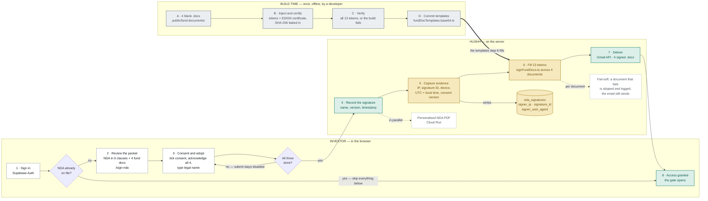

# NDA & Fund Document Signing — Developer Reference

> How an investor's signature is captured, stamped with evidence, applied to four
> agreements, and delivered. Built entirely in-house.

**There is no DocuSign, and no other e-signature vendor.** Signing runs on the stack we
already operate: the React web app, one Supabase Edge Function, one Cloud Run service,
and Gmail. The only two mentions of "DocuSign" in this repository are a note in
[`scripts/gen-esign-flow-doc.py`](../scripts/gen-esign-flow-doc.py) saying we deliberately
did *not* use it, and a stale line of marketing copy in
[`src/content/posts/nda/subscriptionAgrementsLLC.tsx`](../src/content/posts/nda/subscriptionAgrementsLLC.tsx).
Neither is an integration.

---

## Contents

- [The flow](#the-flow)
- [Two clocks: build time vs. runtime](#two-clocks-build-time-vs-runtime)
- [Runtime path, file by file](#runtime-path-file-by-file)
- [Build-time path: regenerating the templates](#build-time-path-regenerating-the-templates)
- [Evidence captured at signing](#evidence-captured-at-signing)
- [What gets written where](#what-gets-written-where)
- [Failure behaviour](#failure-behaviour)
- [Gotchas](#gotchas)
- [File index](#file-index)

---

## The flow



A standalone, presentation-quality version of this diagram lives at
[`docs/nda-signing-flow.html`](./nda-signing-flow.html) — open it in a browser.

---

## Two clocks: build time vs. runtime

This is the single most important thing to understand before changing anything here.

| | Build time | Runtime |
| --- | --- | --- |
| **Runs** | Once, by hand, by a developer | On every signature |
| **Entry point** | `node scripts/build-signed-doc-templates.mjs` | `POST /functions/v1/nda-signed-notification` |
| **Does** | All the fragile `.docx` XML surgery | A find-and-replace over 13 tokens |
| **Fails how** | Loudly, at the developer's terminal, before commit | It shouldn't — and if one document does, it degrades instead of erroring |
| **Output** | `fundDocTemplates.base64.ts`, committed | Four signed `.docx` email attachments |

Carving a rubber stamp is delicate work you do once in the workshop, where a mistake is
caught immediately. Pressing it onto paper is instant and hard to get wrong. We carve
offline and press at runtime, deliberately. Keep it that way — **do not move docx
manipulation into the request path.**

---

## Runtime path, file by file

### 1. The gate

[`src/components/GlobalNDAGate.tsx`](../src/components/GlobalNDAGate.tsx) wraps the entire
route tree in [`src/App.tsx`](../src/App.tsx). Every authenticated user is checked against
`checkNDAStatus`. Unsigned users are redirected to `/sign-nda` and cannot reach anything
else, apart from auth routes and an explicit public allowlist.

There is an 8-second boot timeout that resolves the check rather than hanging the app —
worth knowing when debugging a blank screen on first load.

### 2. The signing surface

[`src/pages/sign-nda/index.tsx`](../src/pages/sign-nda/index.tsx) renders the NDA as six
clauses plus the fund-document packet from
[`src/services/nda/ndaDocuments.ts`](../src/services/nda/ndaDocuments.ts)
(`FUND_DOCUMENTS`, `NDA_CONSENT_VERSION`).

Submission is gated on three independent conditions, all of which must hold:

```ts
const canSubmit = agreedToTerms
  && allDocsAcknowledged
  && signerName.trim().length >= 2
  && !isSubmitting;
```

This is not cosmetic. Consent, per-document acknowledgement, and an adopted name are what
distinguish a signature from a form post under ESIGN/UETA. **Do not relax this to unblock
a test.**

### 3. Recording and generating

[`src/services/nda/ndaService.ts`](../src/services/nda/ndaService.ts) does three things
from the browser:

| Function | Target |
| --- | --- |
| `signNDA` | Supabase RPC → `nda_signatures` + `onboarding_data` |
| `generateNDAPdf` | Cloud Run `POST {base}/generate-nda`, returns a PDF blob |
| `sendNDANotification` | Supabase Edge Function `nda-signed-notification` |

The Cloud Run base URL is resolved in
[`src/services/runtime/mainWeb.ts`](../src/services/runtime/mainWeb.ts) — `VITE_NDA_GENERATION_URL`
when set, otherwise the committed default (`hushhtech-nda-generation`, `us-central1`).

### 4. The signing service

[`supabase/functions/nda-signed-notification/index.ts`](../supabase/functions/nda-signed-notification/index.ts)
is the orchestrator. In order:

1. **Captures the client IP from `x-forwarded-for`**, set by Google Cloud / Supabase — the
   body is never trusted for it. A browser can claim any IP; the header cannot be forged by
   the page.
2. Calls `buildSignedFundDocs` with signer name, email, timestamps, IP, user-agent,
   signature ID and consent version.
3. Updates `nda_signatures` with `signer_ip`, and (best-effort) `signature_id` and
   `signer_user_agent`.
4. Sends two emails through the Gmail API (`gmail.send` scope, Google service account with
   domain-wide delegation): the signer receives the signed pack, the admin receives a
   notification.

### 5. The signer

[`supabase/functions/nda-signed-notification/signFundDocs.ts`](../supabase/functions/nda-signed-notification/signFundDocs.ts)
is intentionally boring. It unzips each committed template, replaces 13 tokens, rezips,
and returns base64 attachments. That is the whole file.

```
{{GP_SIGNATURE}}  {{GP_DATE}}
{{LP_SIGNATURE}}  {{LP_NAME}}  {{LP_DATE}}
{{SIG_ID}}  {{SIG_NAME}}  {{SIG_EMAIL}}
{{SIG_SIGNED_UTC}}  {{SIG_SIGNED_LOCAL}}
{{SIG_IP}}  {{SIG_DEVICE}}  {{SIG_CONSENT}}
```

The General Partner signatory is a constant in that file
(`GENERAL_PARTNER_SIGNATORY = "Manish Sainani"`). All values are XML-escaped before
substitution.

---

## Build-time path: regenerating the templates

Run this whenever a source agreement in `public/fund-documents/` changes:

```bash
node scripts/build-signed-doc-templates.mjs
```

[`scripts/build-signed-doc-templates.mjs`](../scripts/build-signed-doc-templates.mjs) reads
the four blank documents, and for each one:

1. Computes the **SHA-256 of the exact source bytes** — this is the fingerprint the signer
   is bound to, and it is baked into the certificate at this point, not at runtime.
2. Applies the document's signature-block strategy:

   | Key | Output filename | Mode |
   | --- | --- | --- |
   | `lp-master-lpa` | `LP-Master-LPA-Signed.docx` | `existing` — tokenise the GP block already in the document |
   | `delaware-feeder-lpa` | `Delaware-Feeder-LPA-Signed.docx` | `existing+lp` — tokenise GP, inject an LP block after the counterpart note |
   | `investment-prospectus` | `Investment-Prospectus-Signed.docx` | `append` — add a full acknowledgement + signature page |
   | `ppm` | `Private-Placement-Memorandum-Signed.docx` | `append` — same |

3. Appends the **Electronic Signature Certificate** page, containing the `{{SIG_*}}` tokens
   and the fingerprint from step 1.
4. **Verifies all 13 tokens are present**, and exits non-zero if any is missing.

It writes two artefacts:

- `supabase/functions/nda-signed-notification/templates/<key>.docx` — for human review
- `supabase/functions/nda-signed-notification/fundDocTemplates.base64.ts` — the runtime source

> `fundDocTemplates.base64.ts` is **auto-generated. Never hand-edit it.** Change the source
> `.docx` or the script, then re-run and commit both.

---

## Evidence captured at signing

| Evidence | How | Stored |
| --- | --- | --- |
| Signer identity | Typed name + account email | `nda_signatures` + certificate |
| Intent / consent | Explicit tick, with the consent version recorded | `consent_version` + certificate |
| Signature ID | `crypto.randomUUID()`, one per signing event | `signature_id` + certificate + documents |
| Timestamp | UTC and signer-local | Certificate |
| IP address | Server-side from `x-forwarded-for` | `signer_ip` + certificate |
| Device | Browser / OS user-agent | `signer_user_agent` + certificate |
| Documents | Names of the agreements acknowledged | `documents_acknowledged` |
| Integrity | SHA-256 of the source document, fixed at build time | Certificate, per document |

Classification: **Simple Electronic Signature with a captured audit certificate**, mapped to
the US ESIGN Act (2000) and UETA. The certificate plus the database row together form the
audit trail.

Deliberately deferred, pending counsel: embedded PKI/PAdES signatures, RFC-3161 trusted
timestamps, a hash-chained audit log, step-up OTP at signing, consumer-vs-entity signing
authority, per-document proof-of-view, GP counter-signature workflow, WORM retention.

---

## What gets written where

**`nda_signatures`** — the audit record. RLS-protected, service-role writes only.
Columns of interest: `signer_ip`, `signature_id`, `signer_user_agent`, `consent_version`,
`documents_acknowledged`, `pdf_url`.

**`onboarding_data`** — the onboarding record. `nda_signed_at`, `nda_version`,
`nda_signer_ip`, `nda_signer_name`, and `n_url` (the link to the stored NDA PDF).

> Note: [`docs/KYC_ONBOARDING_ARCHITECTURE.md`](./KYC_ONBOARDING_ARCHITECTURE.md) documents
> this column as `nda_pdf_url`. The live column is **`n_url`** — see
> `supabase/manual-sql/migrations/RUN_NDA_MIGRATION.sql`. Trust the migration, not that doc.

---

## Failure behaviour

- **A single document fails to render.** `buildSignedFundDocs` catches per template, logs
  `[signFundDocs] failed to sign <key>`, and continues. The signer still receives the email
  with whatever rendered. This is intentional — a malformed template must not cost the
  investor their completed signing.
- **`signature_id` / `signer_user_agent` columns missing.** The update is wrapped and warns
  rather than throwing, so an un-migrated environment still signs and still emails.
- **Missing token at build time.** The build prints `✗ <key>: missing token <tok>` and exits
  non-zero. Nothing reaches the runtime path.

---

## Gotchas

1. **`fundDocTemplates.base64.ts` is generated.** Editing it by hand puts the committed
   templates out of sync with `public/fund-documents/`, and the certificate fingerprints
   will no longer match the sources they claim to fingerprint.
2. **The fingerprint is a build-time value.** It describes the *source* document version, not
   the per-signer output. Changing a source `.docx` without re-running the script leaves a
   certificate asserting a hash for a document that no longer exists.
3. **Never accept the IP from the request body.** The whole evidentiary value of `signer_ip`
   rests on it being server-attested.
4. **`fflate` is imported bare.** Mapped in `deno.json` for Deno, resolved from
   `node_modules` under vitest. That is what keeps `signFundDocs.ts` unit-testable — don't
   replace it with a URL import.
5. **The GP signatory is hardcoded.** If the signing authority changes, it changes in
   `signFundDocs.ts` *and* in the appended signature page inside
   `build-signed-doc-templates.mjs`.

---

## File index

| Path | Role |
| --- | --- |
| [`src/components/GlobalNDAGate.tsx`](../src/components/GlobalNDAGate.tsx) | Site-wide gate |
| [`src/pages/sign-nda/index.tsx`](../src/pages/sign-nda/index.tsx) | Signing surface |
| [`src/services/nda/ndaService.ts`](../src/services/nda/ndaService.ts) | Record, generate PDF, notify |
| [`src/services/nda/ndaDocuments.ts`](../src/services/nda/ndaDocuments.ts) | Packet definition, consent version |
| [`src/services/runtime/mainWeb.ts`](../src/services/runtime/mainWeb.ts) | Cloud Run URL resolution |
| [`supabase/functions/nda-signed-notification/index.ts`](../supabase/functions/nda-signed-notification/index.ts) | Orchestrator, evidence capture, email |
| [`supabase/functions/nda-signed-notification/signFundDocs.ts`](../supabase/functions/nda-signed-notification/signFundDocs.ts) | Runtime token substitution |
| `supabase/functions/nda-signed-notification/fundDocTemplates.base64.ts` | Generated templates — do not edit |
| [`scripts/build-signed-doc-templates.mjs`](../scripts/build-signed-doc-templates.mjs) | Build-time template generator |
| [`scripts/gen-esign-flow-doc.py`](../scripts/gen-esign-flow-doc.py) | Generates the architecture PDF |
| `public/fund-documents/*.docx` | The four blank source agreements |
| [`docs/nda-signing-flow.html`](./nda-signing-flow.html) | Presentation version of the diagram |

Signing work landed across PRs #1870, #1871, #1872 and #1878.

*Informational, not legal advice.*
