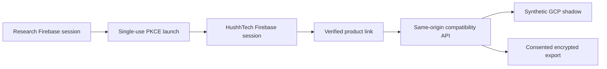

# Hushh Research UAT Client

Status: UAT only, synthetic cohort, default off. Production and every existing
Supabase surface remain unchanged.

## Visual Context

Hushh Research remains the authority for Firebase identity, consent,
revocation, connector cryptography, private-place access, and Research PKM.
HushhTech is a product client. It never connects to Research Cloud SQL and it
never receives an owner token, Research private key, key wrapper, or raw PKM
endpoint.

## Sign-in and identifiers

The Firebase UID is the only account key. Email, phone, and provider aliases are
never mapping keys.

1. HushhTech creates a PKCE S256 verifier, challenge, and random state.
2. The server keeps them in a signed, secure, HTTP-only, same-site cookie for 60
   seconds and opens the Research launch page.
3. Research verifies its existing Firebase session and returns a one-time code
   to the exact UAT callback.
4. HushhTech consumes the cookie and exchanges the code once.
5. The browser exchanges the returned Firebase custom token against the exact
   `hushh-pda` authority.
6. The session adapter preserves the current auth-provider interface. A Research
   cohort session cannot fall back to Supabase.

Every server-side Firebase check requires the product claims minted by the
Research launch exchange: `product_client=hushh-tech`, the exact developer app
and audience, a non-empty launch authorization id, and a safe non-negative
launch revocation watermark. A normal token from the shared Firebase project is
not a HushhTech product session and is rejected before the Firebase lookup.

The callback requires `source=hushh-research`, the original state, the exact
audience `hushh-tech-uat`, and
`https://uat.hushhtech.com/auth/hushh-research/callback`.

## Same-origin routes

| Method | Route | Purpose |
| --- | --- | --- |
| `GET` | `/api/hushh-research/config` | Return the default-off state and public Firebase client config only when enabled |
| `POST` | `/api/hushh-research/launch/start` | Create the signed state and PKCE cookie, then return the Research launch URL |
| `POST` | `/api/hushh-research/launch/exchange` | Consume the callback once and return the Firebase custom token |
| `GET` | `/api/hushh-research/link/status` | Read the current product-link state |
| `POST` | `/api/hushh-research/link/verify` | Link one checked-in synthetic fixture |
| `POST` | `/api/hushh-research/link/revoke` | Revoke the active product link |
| `GET` | `/api/hushh-research/compatibility/:recordType` | Read `profile`, `onboarding`, `access_state`, or `report_asset` metadata |
| `POST` | `/api/hushh-research/consent/request` | Request one allowlisted Research scope |
| `GET` | `/api/hushh-research/consent/status` | Read the current consent state |
| `POST` | `/api/hushh-research/export/decrypt` | Fetch and decrypt one app-bound export on the server |

Every product response is private and non-cacheable. Typed failures are
`UNAUTHENTICATED`, `LINK_REQUIRED`, `LINK_CONFLICT`, `CONSENT_REQUIRED`,
`UPSTREAM_UNAVAILABLE`, `STALE_SHADOW`, and `FEATURE_DISABLED`. Raw upstream
errors and credentials never reach the browser.

Link and consent responses are projected into fixed local shapes. Unknown
upstream error codes or unexpected code/status pairs become
`UPSTREAM_UNAVAILABLE` with a local message; upstream codes, messages, and
extra fields are never forwarded. The only consent scope enabled for this UAT
client is `attr.identity.name`. Consent status may be queried by request id,
but any supplied or returned scope must still be that exact scope.

## Compatibility boundary

The first cohort contains only synthetic profile, onboarding, access-state, and
report-asset metadata. The gateway preserves stable response shapes and does not
invent missing URLs or product states. Payments, Plaid, KYC, NDA records,
webhooks, storage objects, and live-only functions remain legacy and unavailable
to this cohort.

The server derives the synthetic legacy proof from an exact UID-to-fixture
binding. The proof is signed with the dedicated developer credential and binds
the Firebase UID, app id, audience, fixture hash, one-time session id, and short
expiry. Research independently validates the Firebase bearer, product token,
fixture hash, and proof replay state.

## Connector boundary

The HushhTech connector private key lives only in UAT Secret Manager. Research
stores the matching X25519 public key. The server accepts only the registered
envelope version, algorithm, key id, scope, recipient fingerprint, additional
authenticated data, and ciphertext digest. It rejects altered data, a wrong
connector, scope mismatch, and stale exports. After decrypting and validating an
export, the server must atomically create its SHA-256 consumption record in the
existing `hushh-tech-uat` default Firestore database before it can return any
plaintext. Records live in `hushh_research_export_consumptions`; the existing
UAT runtime identity has `datastore.entities.create` through its current Editor
binding, so this adds no IAM grant or infrastructure. A duplicate record is a
replay; an authentication, network, or Firestore failure fails closed. The
ledger stores only the digest plus consumed and expiry timestamps. Plaintext is
never logged, cached, or sent through a URL.

## Environment contract

UAT is pinned to:

- Research API: `https://api.uat.hushh.ai`
- Research web: `https://uat.one.hushh.ai`
- Firebase project: `hushh-pda`
- audience: `hushh-tech-uat`
- developer app: `app_hushh-technologies_cd1895ef`

The developer token, connector private key, Firebase browser API key, and
Firebase app id are mounted from four UAT-only secrets. No Research credential
is referenced by the production workflow. The server enables the client only
when the runtime is `hushh-tech-uat`, every required value is present, and the
configured cohort is exactly the two checked-in synthetic Firebase UIDs. A
missing UID or any additional UID disables the whole client.

## UAT proof and rollback

The initial deployment keeps the flag off and proves the disabled runtime
contract on the serving revision. The full proof later requires two synthetic
Firebase users in the shared authority, then launch, link, four compatibility
reads, consent, encrypted export, server decrypt, revoke, and post-revoke denial.
No production user or Supabase data is used.

The UAT deploy captures the unique revision serving 100% before it changes
traffic and restores that exact revision if deployment or smoke checks fail.
For the initial cohort enablement, that captured revision is the proven
flag-off release, so the automatic rollback also turns the cohort off. An
operator-triggered rollback first sets the UAT cohort flag to `false`, then
returns traffic to the captured flag-off revision. Research migration 162
remains as an inert additive UAT overlay; no destructive down-migration exists.
