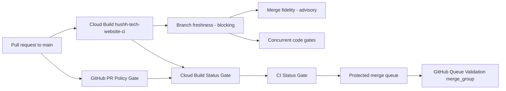

# Cloud Build CI lane

The default pull-request code gate for `hushh-labs/hushh_Tech_website` runs in
Google Cloud Build. The 2nd-generation trigger `hushh-tech-website-ci` uses the
`hushh-github` connection in `hushh-tech-uat` (`us-central1`), matches pull
requests whose base is `main`, and reads `cloudbuild.ci.yaml` from the exact
source revision. It uses the existing project `cloud-run-build` identity (no
deployer or secret accessor), and the status adapter matches the
Cloud Build check by this unique trigger name, so a console URL format change
cannot strand the gate.



## Adding a server route

`server.js` is byte-locked by three Cloud Run candidate registries under
`cloud-run/hushh-tech-app-services/registry/`, so adding an API route is a
reviewed event rather than a silent one. The sequence, in one commit:

```bash
npm run migration:no-hybrid:routes:generate            # refresh the route inventory
node scripts/gcp/migration/repin-runtime-byte-locks.mjs --write
```

then update the hard-coded `server:` count in
`tests/noHybridRouteInventory.test.ts`, which is asserted on purpose.

The repin tool recomputes only values anyone reading the diff can recompute
from committed bytes: the byte locks, each registry's `manifest_self_digest`,
each validator's `EXPECTED_DIGEST`, and the copy of `manifest_self_digest` a
validator restates inline. It never touches `reviewed_commit`, `reviewed_tree`,
trust anchors or base-image digests — those record a human's approval of a
specific tree, and a re-pin means that approval is now stale and someone has to
grant it again.

## Branch freshness and merge fidelity

Two gates run before anything is installed, ported from the equivalents in
`hushh-labs/hushh-research`. They answer different questions and only make
sense together:

| Gate | Question | Mode |
| --- | --- | --- |
| `scripts/git/check-main-sync.sh` | Does this checkout **contain** the base branch's tip? | blocking |
| `scripts/ci/check-merge-fidelity.sh` | Does it still **have the content** those commits landed? | advisory |

Freshness blocks because a branch behind `main` was validated against code
nobody will run, and merging it puts a stale copy of every shared file back
over whatever landed in the meantime. Both are reachable through
`scripts/ci/orchestrate.sh freshness` and `scripts/ci/orchestrate.sh fidelity`,
so the Cloud Build steps and the GitHub steps invoke the identical command and
cannot drift apart.

Freshness runs again inside `scripts/deploy/uat-deploy.mjs`, because CI cannot
cover the deploy. CI validates a pull request; the deploy script ships whatever
is checked out, which is how a branch that was fresh when it was validated
gets shipped hours later over newer work. That failure leaves no conflict and
no failing test — only a revision serving files as they were before a fix.
`--rollback` is never checked (shipping an older image is the point), and
`--allow-stale` is the documented override.

Merge fidelity is advisory because every pass is a text heuristic: it flags a
deliberate supersession as loudly as a silent revert. It reports; a human
decides. It must never be silent about failing to look, so a pass that exits
abnormally is reported as `INCONCLUSIVE` rather than clean. To stand down a
finding, put a `Merge-Regression-Ack: <reason>` trailer in a commit message on
the branch — upstream uses a pull-request label read through `gh`, which a
Cloud Build has no credential or payload for.

Two corrections were made against the upstream implementation, both because
the default runner here is Cloud Build rather than GitHub Actions:

- **No silent skip on a detached HEAD.** Upstream exits 0 when it cannot read a
  branch name. Every Cloud Build checkout is detached, so ported verbatim the
  gate would have reported green on one hundred per cent of builds without ever
  running. Shallow single-branch clones are likewise deepened and fetched
  through an explicit refspec instead of being taken at face value.
- **Pass B was unreachable.** Upstream's second fidelity pass compares the
  branch's fork point to the base tip and skips when they are equal — but the
  passes only run once the base is an ancestor of `HEAD`, and when that holds
  `git merge-base HEAD base` *is* the base. The clean-revert loss mode it names
  therefore went unchecked. Here it walks the branch's sync merges instead and
  asks whether `HEAD` still holds what each merge brought in.

### Reaching the base branch from a build step

A Cloud Build step cannot fetch this repository unaided. The trigger's clone
credential is consumed by the source fetch and is never handed to the steps, so
`git fetch origin main` inside a step runs anonymously — which returns 403 now
that the repository is private. Build `1e1f743b` failed exactly there before
this was addressed.

`scripts/ci/fetch-base-branch.mjs` mints a short-lived read token from the
`hushh-github` 2nd-generation connection and passes it to Git as a
child-process-only HTTP header, the same mechanism and the same
`roles/cloudbuild.readTokenAccessor` grant that `prepare-repository-history.mjs`
already uses. It imports nothing, so it runs before `npm ci` and a stale branch
never pays for a dependency install. The gates then run with
`MAIN_SYNC_FETCH=0`, which requires the ref to be present rather than fetching
it — that is not a bypass, and a missing ref still fails the gate.

The same call precedes the tag-deploy lane in
`deploy/uat-tag-trigger.cloudbuild.yaml` for the same reason.

On GitHub the two gates are steps inside `PR Policy Gate`, not jobs of their
own, so they join the required `CI Status Gate` with no change to the status
adapter. They check `pull_request.head.sha` rather than the checkout:
`actions/checkout` resolves a pull-request event to `refs/pull/N/merge`, which
contains the base tip by construction and would report every pull request fresh.

Cloud Build installs the root dependency tree once with a lockfile-keyed npm
cache, then fans out web tests/type-check/build plus the deploy-context check,
lint, environment and retirement contracts, and the no-hybrid route/source
contract. After the web build completes, the no-hybrid runtime step uses the
version-pinned `mcr.microsoft.com/playwright:v1.57.0-noble` image, performs a
read-only browser inventory, and reuses the web step's `dist/` output for the
artifact/Chromium/WebKit proof. It does not download browsers or build the
application a second time. The remaining steps run the Cloud Run service
checks, npm audit, sensitive NDA regressions, and pinned gitleaks.
A failed step fails the build; cache restore/save is the only best-effort work.
The `repository-history` preparation obtains a short-lived read token from the
existing Cloud Build repository connection, unshallows the exact tested HEAD,
and verifies the pinned recovery revision without moving HEAD. The token is
passed to Git through a child-only HTTP header and is never written to disk,
logs, or the build configuration. The build identity needs only
`roles/cloudbuild.readTokenAccessor`; it does not receive deployer access or a
long-lived GitHub credential. This preserves the historical ancestry proofs
without relying on the source-fetch credential helper, which is unavailable in
ordinary build steps.

The GitHub `PR Policy Gate` is intentionally small. It runs DCO, reviewer
context, PR body hygiene, Phase 2 policy, and the advisory semantic guard because
those checks need GitHub's pull-request payload. `Cloud Build Status Gate` listens
for the Cloud Build and policy check completions, joins their latest results for
the same commit, and publishes the required `CI Status Gate` commit status. A
missing or pending Cloud Build result remains pending; a failure cannot be
hidden by the GitHub backup workflow.

The full `.github/workflows/ci.yml` workflow is named `PR Validation (GitHub
backup)` and is manual-only. Use it when the Cloud Build lane is unavailable and
record the run URL in the release evidence. CodeQL is also manual-only; it is not
part of pull-request, push, or scheduled execution.

`Queue Validation` remains a GitHub `merge_group` workflow. Cloud Build's GitHub
pull-request trigger cannot receive GitHub's synthetic merge-queue ref, so queue
freshness and the final `CI Status Gate` check still run in GitHub before a
protected merge. `Main Post-Merge Smoke` and the existing UAT/production release
workflows remain unchanged.

## Trigger reconciliation

Run the read-only plan first:

```bash
npm run gcp:ci-trigger:plan
```

The plan verifies the connected repository, `^main$` base filter, external
comment-control policy, `cloudbuild.ci.yaml`, the existing builder service
account, and GitHub log status integration.
Run the mutation only after reviewing that output:

```bash
npm run gcp:ci-trigger:apply
```

The helper changes only the named trigger and never grants IAM roles or creates
keys. It is safe to run repeatedly; a matching trigger returns without deleting
or recreating it.
