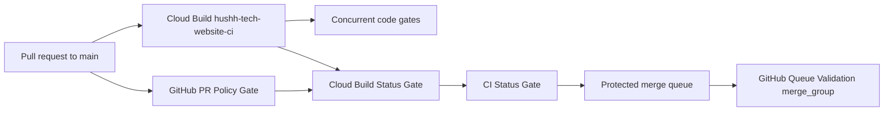

# Cloud Build CI lane

The default pull-request code gate for `hushh-labs/hushh_Tech_website` runs in
Google Cloud Build. The 2nd-generation trigger `hushh-tech-website-ci` uses the
`hushh-github` connection in `hushh-tech-uat` (`us-central1`), matches pull
requests whose base is `main`, and reads `cloudbuild.ci.yaml` from the exact
source revision. It uses the existing project `cloud-run-build` identity (no
deployer or secret accessor), and the status adapter matches the
Cloud Build check by this unique trigger name, so a console URL format change
cannot strand the gate.



Cloud Build installs the root dependency tree once with a lockfile-keyed npm
cache, then fans out web tests/type-check/build plus the deploy-context check,
lint, environment and retirement contracts, and the no-hybrid route/source
contract. After the web build completes, the no-hybrid runtime step uses the
version-pinned `mcr.microsoft.com/playwright:v1.57.0-noble` image, performs a
read-only browser inventory, and reuses the web step's `dist/` output for the
artifact/Chromium/WebKit proof. It does not download browsers or build the
application a second time. The remaining steps run the Cloud Run service
checks, npm audit, sensitive NDA regressions, and pinned gitleaks.
A failed step fails the build; cache restore/save is the only best-effort work.
The `repository-history` preparation obtains a short-lived read token from the
existing Cloud Build repository connection, unshallows the exact tested HEAD,
and verifies the pinned recovery revision without moving HEAD. The token is
passed to Git through a child-only HTTP header and is never written to disk,
logs, or the build configuration. The build identity needs only
`roles/cloudbuild.readTokenAccessor`; it does not receive deployer access or a
long-lived GitHub credential. This preserves the historical ancestry proofs
without relying on the source-fetch credential helper, which is unavailable in
ordinary build steps.

The GitHub `PR Policy Gate` is intentionally small. It runs DCO, reviewer
context, PR body hygiene, Phase 2 policy, and the advisory semantic guard because
those checks need GitHub's pull-request payload. `Cloud Build Status Gate` listens
for the Cloud Build and policy check completions, joins their latest results for
the same commit, and publishes the required `CI Status Gate` commit status. A
missing or pending Cloud Build result remains pending; a failure cannot be
hidden by the GitHub backup workflow.

The full `.github/workflows/ci.yml` workflow is named `PR Validation (GitHub
backup)` and is manual-only. Use it when the Cloud Build lane is unavailable and
record the run URL in the release evidence. CodeQL is also manual-only; it is not
part of pull-request, push, or scheduled execution.

`Queue Validation` remains a GitHub `merge_group` workflow. Cloud Build's GitHub
pull-request trigger cannot receive GitHub's synthetic merge-queue ref, so queue
freshness and the final `CI Status Gate` check still run in GitHub before a
protected merge. `Main Post-Merge Smoke` and the existing UAT/production release
workflows remain unchanged.

## Trigger reconciliation

Run the read-only plan first:

```bash
npm run gcp:ci-trigger:plan
```

The plan verifies the connected repository, `^main$` base filter, external
comment-control policy, `cloudbuild.ci.yaml`, the existing builder service
account, and GitHub log status integration.
Run the mutation only after reviewing that output:

```bash
npm run gcp:ci-trigger:apply
```

The helper changes only the named trigger and never grants IAM roles or creates
keys. It is safe to run repeatedly; a matching trigger returns without deleting
or recreating it.
