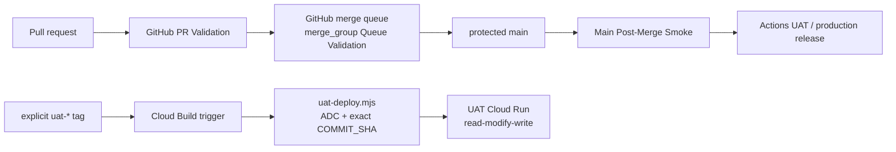

# Direct GCP deployment lane

Hushh Tech has two separate control planes:

The GitHub path owns review, freshness, protected merging, and release approval. The optional Cloud Build path is an operator-invoked UAT execution lane for a repository that needs to reduce GitHub-hosted runner usage. It reuses [`scripts/deploy/uat-deploy.mjs`](../../../scripts/deploy/uat-deploy.mjs), which changes only the image, `DEPLOY_COMMIT_SHA`, and revision labels on the existing Cloud Run service. It does not replace the service's environment or secret bindings.

## How to use it

1. Confirm the Cloud Build 2nd-generation GitHub connection links `hushh-labs/hushh_Tech_website` and that the dedicated UAT deployer service account has already been granted its reviewed roles. The registration script never grants IAM roles or creates keys.
2. Run `npm run gcp:uat-trigger:plan`. Review the repository resource, tag filter, config path, and service account. The command is read-only.
3. Run `npm run gcp:uat-trigger:apply` only after that review. It reconciles the named trigger and replaces a mismatched configuration instead of silently accepting stale settings.
4. Create an explicit tag for the commit to exercise UAT, for example `git tag uat-<commit-id> && git push origin uat-<commit-id>`. The Cloud Build source supplies `COMMIT_SHA`; the helper requires that value and archives the trigger checkout when `.git` is absent.
5. Inspect the Cloud Build result and the UAT Cloud Run revision. The helper writes a rollback image reference before patching and fails if the plain or secret environment counts change.

The tag lane is intentionally UAT-only. A tag can point at a topic commit, so its result is a branch-preview deployment and is not evidence that the commit is eligible for production. Production remains the manual, green-`main` Actions workflow until a separate design binds an immutable UAT verification receipt, environment-neutral artifact, serving revision, smoke result, and automatic rollback. Do not promote a UAT image that embeds UAT browser callback or KYC values into production.

The trigger configuration is part of this repository so the deployed build definition is reviewable alongside the helper it invokes. Updating the Cloud Build trigger is a separate, explicit infrastructure operation.

## Private-repository readiness

Changing repository visibility does not itself move CI or deploy execution. Before making the repository private, verify the organization plan supports the protected ruleset and merge queue, confirm the Cloud Build GitHub App connection still has repository access, and rehearse the required `merge_group` status checks. Keep the GitHub `merge_group` workflow while Cloud Build validation is being evaluated; it is the status-bearing freshness gate for the protected queue.

The two lanes must not be configured as competing automatic deploys. Use GitHub for merge and approved release orchestration, and use the direct Cloud Build trigger only for an explicit UAT execution. Record the resulting build ID, source SHA, image digest, serving revision, and verification outcome in the release evidence used for any later promotion.
